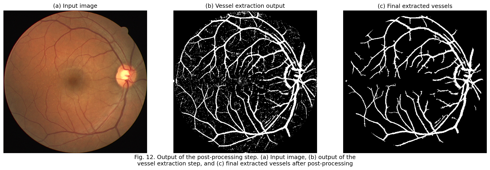
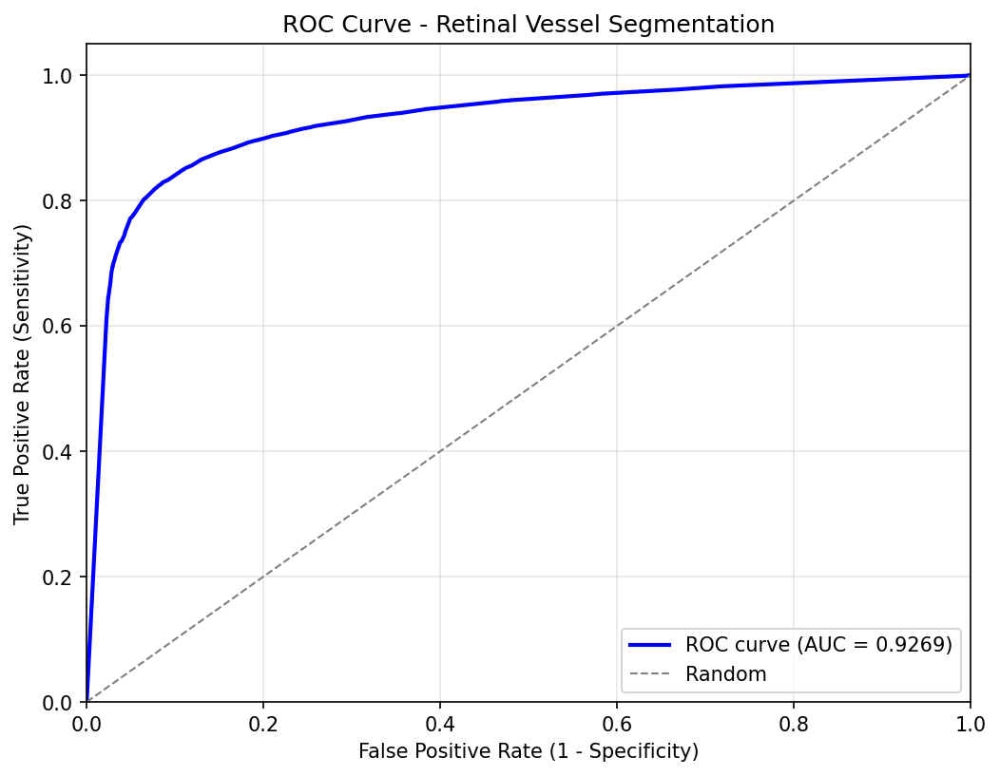

# Retinal Blood Vessel Extraction

A Python/OpenCV implementation of retinal blood vessel segmentation on the
**DRIVE** dataset, reproducing the hybrid supervised + unsupervised pipeline of
Hashemzadeh & Adlpour Azar (2019). The method combines handcrafted image
features with **PCA → Fuzzy C-Means clustering → Decision Tree** classification
and reaches **0.929 accuracy / 0.927 AUC** on the DRIVE test set.



*November 2025*

---

## Results

Evaluated on the DRIVE test images (vessel pixels within the field of view):

| Metric | Score |
|---|---|
| Sensitivity | 0.748 |
| Specificity | 0.954 |
| PPV | 0.693 |
| Accuracy | **0.929** |
| AUC | **0.927** |



Per-image numbers are in [`outputs/table_1.csv`](outputs/table_1.csv); stage-by-stage
figures (preprocessing, Gabor responses, FCM, classification, post-processing)
are under [`figures/`](figures/).

---

## Method

1. **Preprocessing** — FOV extraction with the provided masks, conversion to
   L\*a\*b and YCbCr, channel selection (G, L, Y), and CLAHE contrast enhancement.
2. **Feature extraction (13 features)** — 9 Gabor responses (3 wavelengths × 3
   channels) plus Top-Hat, shade-correction, bit-plane and a CLAHE-enhanced
   channel.
3. **Dimensionality** — PCA over the 13-dimensional feature space.
4. **Segmentation** — unsupervised Fuzzy C-Means clustering combined with a
   supervised Decision Tree, trained with class-balanced pixel sampling
   (up to 5,000 vessel + 5,000 background pixels per image, seed-fixed).
5. **Post-processing** — morphological cleanup of the combined vessel map.

---

## Project Structure

```
retinal-vessel-extraction/
├── main.py                 # End-to-end pipeline
├── preprocessing.py        # FOV crop, colour conversion, CLAHE
├── feature_extraction.py   # Gabor + Top-Hat + bit-plane + spatial features
├── vessel_extraction.py    # PCA, FCM, Decision Tree, combination
├── evaluation.py           # Sensitivity / Specificity / PPV / Accuracy / AUC
├── create_figures.py       # Regenerates the paper-style figures
├── figures/                # Pre-generated result figures
├── outputs/                # Metrics table + ROC curve
└── requirements.txt
```

---

## Setup

```bash
pip install -r requirements.txt
```

The DRIVE dataset is **not** included (licensing + size). Download it and place
it as:

```
data/
├── training/   # images/ , mask/ , 1st_manual/
└── test/       # images/ , mask/
```

DRIVE is available at <https://drive.grand-challenge.org/>.

## Run

```bash
python main.py
```

Outputs (figures + `table_1.csv` + `roc_curve.png`) are written to `outputs/`.

---

## Reference

Hashemzadeh, M., & Adlpour Azar, B. (2019). *Retinal blood vessel extraction
employing effective image features and combination of supervised and
unsupervised machine learning methods.* Artificial Intelligence in Medicine, 95,
1–15.
